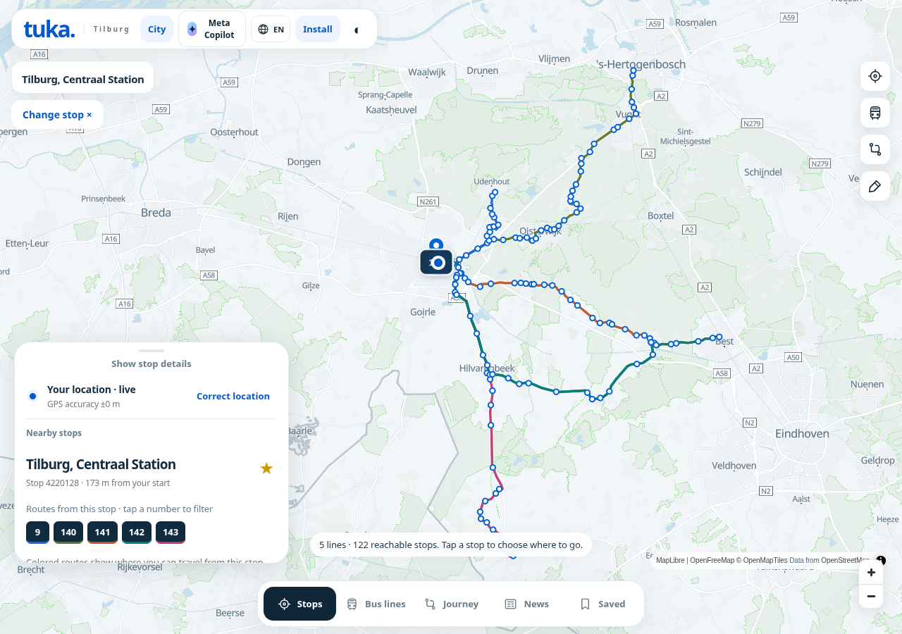
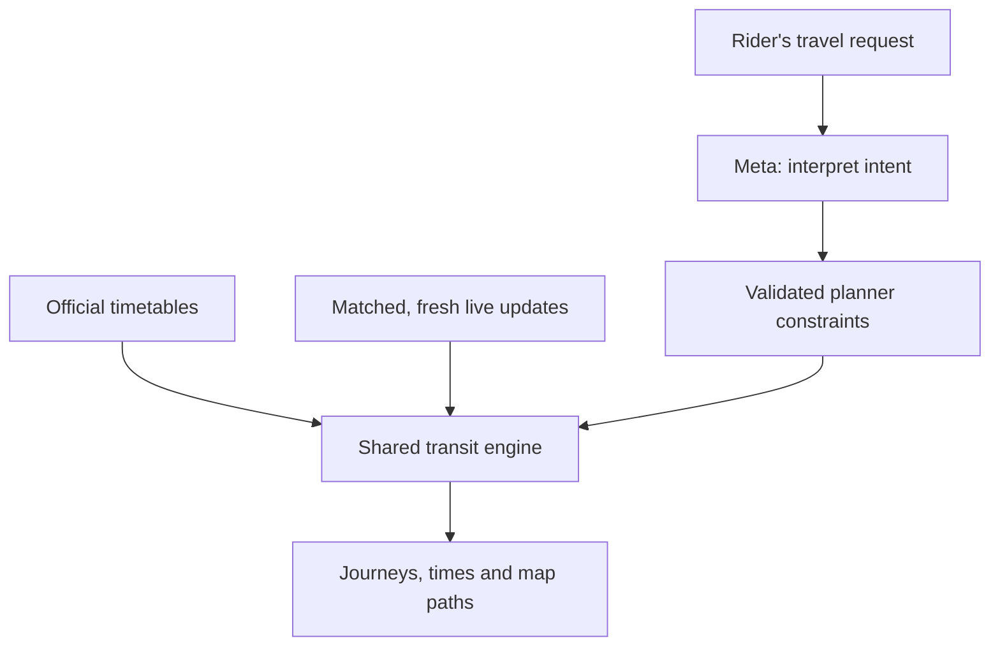
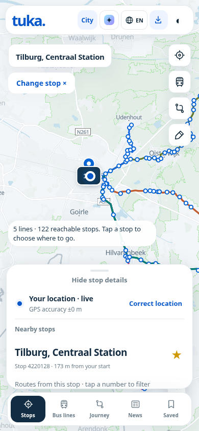
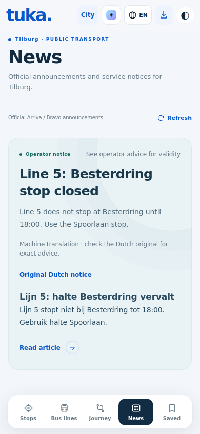

# tuka.

### Your city changes. Your way home should still feel familiar.

**A map-first public transport app becoming a shared transit experience across cities, countries and languages.**

Built in Skopje. Extended to Boston. Now being tested for Tilburg.

**3 city networks · one shared journey engine · official public data · Meta-powered assistance**

[Explore the judging host](https://tuka.meta-cerebralvalley.rand0m.net) · [Follow the evidence](#built-to-be-inspected) · [Run it yourself](#run-tuka) · [See the roadmap](#where-tuka-goes-next)

> **Submission status:** this branch, `codex/meta-hackathon`, contains the latest published implementation. The judging host requires credentials. Deployment of the latest branch updates and Tilburg field acceptance remain pending; the hosted demo may show an earlier build.



*Browser capture from the Tilburg pilot. The interface, route overlays and city data are implemented; the capture predates the latest geometry and startup updates.*

## A familiar feeling in an unfamiliar city

You arrive somewhere new. You need to reach a university, a hospital, a station or home. The useful questions are immediate:

- Which stop should I use—and on which side of the road?
- Does this bus actually take me where I need to go?
- Can I make the connection and arrive before my deadline?
- Is the arrival live, or just the timetable?
- What does the operator's disruption notice mean?

Tuka brings those questions into one place: **tap a stop, see its routes, understand the journey, and keep the information you need for the next ride.**

The larger idea grows from that everyday experience: a rider should be able to change cities and keep a familiar way of navigating public transport.

## What you can do today

| Rider action | What Tuka provides |
| --- | --- |
| **Find my network** | GPS-based selection among supported cities, with a manual chooser when needed. |
| **Tap a stop** | Boarding routes, directional paths, reachable stops and upcoming departures. |
| **Understand the map** | Consistent route colors, validated published shapes, and clearly marked approximations where the source is incomplete. |
| **Get somewhere on time** | Leave now, leave at or arrive by; compare journeys with up to two transfers. |
| **Make the journey fit** | Fastest, fewest transfers or least walking, with walking-speed, total-walking and transfer-buffer controls. |
| **Follow a ride** | Journey and ride guidance with stop progress and get-off prompts while the app remains active. |
| **Keep my regulars** | City-specific saved stops, route filters, commutes and Home/Work places. |
| **Understand a disruption** | Official notices, affected-service information, and an English option for Tilburg notices with the original retained. |
| **Ask naturally** | Meta Copilot for city context and a structured handoff into the ordinary journey planner. |
| **Stay useful offline** | Downloaded timetable basics and saved information; live information requires a connection. |

The same Stops, Bus lines, Journey, News and Saved screens serve all three networks. Each city brings its own data and capabilities into that shared interface.

## The hackathon leap: one local app, three different transit systems

Tuka began as a working Skopje PWA. The hackathon work extends that foundation into a city-aware system rather than building a separate app for every new place.

### What existed before

The Skopje foundation already included the map, arrivals, transfer planning, saved journeys, offline basics, news, language selection, dark mode and a local QR-card wallet. These are established product capabilities, **not claimed as new hackathon work**.

### What this submission adds

- **A shared city-provider architecture.** Boston and Tilburg replace the actual timetable and saved state used by the main application. Their maps and planner use their own networks.
- **A complete Boston bus timetable.** Official MBTA data is compiled into a compact asset with calendars, original identifiers, stop calls, shapes and directional variants preserved.
- **A regional Netherlands ingestion pipeline.** Tuka extracts complete bus trips serving Tilburg and its defined connection area from the national feed, retaining calls beyond the selection boundary.
- **Official realtime adapters.** Trip updates, vehicle positions and service alerts enter the common transit engine with identity, freshness and service-date checks.
- **City-aware behavior throughout.** Time zones, after-midnight service, shared links, saved places, notices and asynchronous requests follow the selected city.
- **A grounded AI workflow.** Natural-language requests become validated planner constraints. Meta provides the primary model integration; Baseten can supply a configured fallback for journey interpretation and notice translation.
- **English access to Tilburg notices.** Prefer official English text; otherwise request a labelled machine translation while keeping the original advice available.
- **Evidence and regression coverage.** Source comparisons, geometry audits and browser checks accompany the implementation.

[Implementation record →](reports/universal-transit.md) · [Tilburg build and acceptance record →](reports/tilburg/roadmap.md)

## Three cities. Real timetable depth.

| Network | Public data foundation | Routes in the assessed feed | Usable trips |
| --- | --- | ---: | ---: |
| **Skopje, North Macedonia** | Modeshift GTFS, with existing local live-data integrations | 101 | 4,051 |
| **Boston, United States** | Official MBTA GTFS and GTFS-Realtime | 369 | 86,996 |
| **Tilburg region, Netherlands** | OVapi national GTFS and GTFS-Realtime; regional bus selection including Arriva / Bravo | 100 | 16,873 |

*Inventory figures describe the assessed feeds, not services operating simultaneously. Calendars and exceptions determine which trips run on a selected date. Skopje figures come from the November 2 source audit; Boston and Tilburg figures describe the bundled snapshots. Boston coverage is buses and shuttles; the Tilburg partition is bus-only.*

### A small download with complete regional trips

The Tilburg browser asset is approximately **2.1 MB**, selected from a national archive of roughly **205 MB**. Complete selected trips are retained, including stops outside the initial geographic bounds.

The source comparison checked **407,058 stop calls across 16,873 trips**, including **6,109 calls at or beyond 24:00**. It found **zero mismatches** in the compared identifiers, stop order, arrival/departure times and boarding/alighting restrictions.

That is a reproducible data-integrity check—not a claim that every real-world bus will run exactly as scheduled.

[Inspect the source comparison →](reports/tilburg/source-verification.json) · [Inspect ingestion provenance →](reports/tilburg/ingestion.json)

## AI that helps a rider express the journey

A rider can ask:

> “Get me to Tilburg Centraal by 09:00 tomorrow, with no more than ten minutes of walking.”

Tuka's journey-intent endpoint asks for one structured tool call containing places, date, time, route preference and walking limit. The server validates it. The rider resolves any ambiguous stop or platform, reviews the interpreted fields, then asks the shared planner to calculate journeys from the timetable.



The model cannot submit an invented itinerary as a planner result. Routes, calls and times come from the transit engine. General Copilot answers use verified city context and available provider checks.

For Tilburg news, **Read in English** translates a current official notice on demand. The original remains expandable; machine output is labelled, changed numeric details are rejected, and source-controlled validity and URLs remain intact. Translations are cached by their exact source text.

**Verification boundary:** structured contracts, fallback behavior and translation controls have automated and mocked-browser coverage. A real provider round trip for the new journey-intent and notice-translation flows remains unverified locally. Model credentials stay server-side.

## A three-minute tour for judges

1. **Choose a network.** Use **City** to select Skopje, Boston or Tilburg. GPS can select a supported network automatically; the chooser also lets you explore somewhere else.
2. **Start at a stop.** In Tilburg, try **Tilburg, Centraal Station**. Tap a route number to filter its path and inspect reachable stops.
3. **Make a journey.** Open **Journey**, choose actual stops or places, and try an arrive-by deadline with a walking limit. Use a date within the published timetable.
4. **See the city actually change.** Switch to Boston. Inspect its Bus lines, then return to Tilburg. The same interface now operates on a different timetable and city-specific saved state.
5. **Inspect the AI boundary.** In Copilot, choose **Plan a journey**, enter a request, and review the fields before planning. This step requires configured model credentials.
6. **Read local advice.** Open Tilburg **News**. Where a Dutch notice is available, use **Read in English**, then expand the original. Notice availability depends on the live operator feed; machine translation requires configured credentials.

**A useful demonstration:** save a stop in one city, switch networks, then switch back. Tuka keeps the rider's regulars tied to the right city.

<details>
<summary><strong>More of the interface</strong></summary>

| Stops on a phone | English notice with its Dutch original |
| --- | --- |
|  |  |

The stop capture comes from the earlier Tilburg pilot. The English-notice capture is a browser test using a mocked translation and example disruption; it does not claim that disruption is currently active.

</details>

## Built to be inspected

Reliability is part of the product experience: a timetable should remain usable when live data disappears, and a map should distinguish an actual published path from an approximation.

| Evidence | What it establishes |
| --- | --- |
| **172 passing Node tests**, plus standalone regression checks | Coverage across authentication, planning, calendars, realtime matching, geometry, city isolation, saved state, offline basics, notices and translations. |
| **407,058 source calls compared; zero mismatches** | The Tilburg partition preserves the compared fields of its retained source trips. |
| **Geometry audits across all three assessed networks** | Seven Skopje, eleven Boston and three Tilburg patterns recover legitimate published paths after fixing ordered stop-to-shape matching. |
| **Browser GPS and city-switch checks** | Tilburg GPS overrides a stale saved Skopje preference; a first visit with denied location opens the chooser without downloading a default network. |
| **Local return switches of 180–316 ms** | In the recorded preview, normalized timetable reuse avoided repeat downloads and parsing. First Boston load took about 2.4 seconds; these are local measurements, not mobile-network guarantees. |
| **Meta build and Worker dry-run pass** | The protected build packages successfully. This does not establish a live deployment. |

Useful implementation details behind those checks:

- Stop-to-shape matching follows ordered segments through loops. Boarding and journey paths trim at projected segment positions.
- Live positions and predictions need compatible trip, route, stop-sequence and service-date identifiers. Stale or unmatched records are excluded.
- Agency time zones, service exceptions and trips after midnight are handled explicitly.
- City-load generations prevent a late response from redrawing the previous network.
- Timetables are reused in memory for five minutes; concurrent requests share a load. The artificial ten-second startup delay has been removed.
- Tilburg's national realtime feeds are filtered to the regional dataset before delivery to the browser.

**Open the receipts:** [Skopje audit](reports/skopje-route-audit.json) · [Boston audit](reports/boston-route-audit.json) · [Tilburg audit](reports/tilburg-route-audit.json) · [Startup and route checks](reports/routes-and-startup.md) · [Switch timings](reports/city-switch-browser-check.json) · [English-notice checks](reports/other-cities-and-english.md)

## Where Tuka goes next

The destination is **one familiar transit companion across supported cities**—with each city supplying its own network, language, operators and available live data.

The next steps have a deliberate order:

| Stage | What it would unlock | What must be proved first |
| --- | --- | --- |
| **1 · Prove Tilburg in the field** | Confidence in actual stops, transfers, disruption advice and live arrival coverage. | Real journeys with the local tester, a live model round trip, and fixes from that feedback. |
| **2 · Make city onboarding repeatable** | Add a compatible city through a provider profile and a verified ingestion pipeline. | Consistent source licensing, calendars, geometry and realtime acceptance checks. |
| **3 · Build the global feed library** | Discover supported networks and download only the relevant regional data. | Accepted Tilburg behavior, repeatable partitions and reliable feed refresh. |
| **4 · Expand the travel experience** | More modes, stronger accessibility information, richer offline packs and cross-network journeys. | Suitable public sources and measured reliability for each capability. |
| **5 · Make the platform reusable** | Explore shared components or integrations for campuses, municipalities and transport-facing services. | Operational maturity and evidence of rider demand. |

These are future directions, not shipped coverage or announced partnerships. The global library remains paused until the Tilburg pilot is accepted.

The architecture already connects three differently shaped transit systems to one passenger interface. The opportunity is to make that process repeatable while keeping the rider experience clear and the underlying evidence visible.

## Current boundaries

Tuka is a tested pilot with meaningful coverage and work still to prove:

- **Coverage follows public sources.** Boston currently covers buses/shuttles; Tilburg covers the defined regional bus partition. Other cities and modes are not implied.
- **Some source geometry is incomplete.** Tilburg has 41 patterns with no published shape. Two Boston shuttle patterns still fail validation. Skopje's latest audit retains one rejected shape and four patterns without shapes. Dashed bus outlines are approximate stop connections; dashed journey walking links indicate walking.
- **Schedules have an expiry.** Boston and Tilburg static data are build-time snapshots with finite service calendars. They need rebuilding as operators publish updates. Live feeds do not extend those calendars.
- **Walking and ride alerts have practical limits.** The Meta Worker currently lacks the D1 binding needed for street-walking refinement, so walks remain labelled estimates. Phone backgrounding or locking can pause tracking and alerts.
- **Local capabilities remain local.** Skopje news, its passenger-report integration and the SkopjeBus ticket handoff do not become universal ticketing. Automatic SMS ticket capture requires native integration.
- **Acceptance is still in progress.** Tilburg field testing, new live-model verification and deployment of the latest updates remain pending. Recent street-tile loading was unreliable in this development environment; neutral-basemap overlay checks are identified in the evidence.

## Run Tuka

Use **Node.js 22 or newer** and Python 3 for feed ingestion scripts.

```sh
npm ci
cp .env.example .env
```

Fill the ignored `.env` with a local `META_AUTH_PASSWORD`. Add `MODEL_API_KEY` for Meta Copilot, journey interpretation and notice translation. For an optional fallback, set `BASETEN_API_KEY` and an account-available, tool-capable `BASETEN_MODEL`. The login username is configured in `wrangler.meta.jsonc`.

```sh
npm run dev:meta
```

The protected local pilot runs on port **8793**. Its dev command explicitly loads `.env`. Timetable exploration works without a model key; model features report their configuration state. Keep credentials out of `dist/` and Git.

Run the verification and production asset build:

```sh
npm test
npm run build:meta
```

<details>
<summary><strong>Refresh the Boston or Tilburg timetable</strong></summary>

Download the official [MBTA GTFS ZIP](https://cdn.mbta.com/MBTA_GTFS.zip), then compile and inspect the Boston asset:

```sh
python3 scripts/build-transit-feed.py /path/to/MBTA_GTFS.zip dist/boston-network.bin
node scripts/diagnose-transit.mjs boston dist/boston-network.bin reports/boston-gtfs-diagnostic.json 2026-11-02 1
```

For Tilburg, download the [national OVapi GTFS ZIP](https://gtfs.ovapi.nl/nl/gtfs-nl.zip), rebuild the regional schedule and index together, and compare the retained calls with the original:

```sh
python3 scripts/build-netherlands.py /path/to/gtfs-nl.zip /tmp/tuka-tilburg
cp /tmp/tuka-tilburg/tilburg-network.bin dist/tilburg-network.bin
cp /tmp/tuka-tilburg/tilburg-index.json dist/tilburg-index.json
cp /tmp/tuka-tilburg/tilburg-ingestion.json reports/tilburg/ingestion.json
python3 scripts/verify-netherlands.py /path/to/gtfs-nl.zip dist/tilburg-network.bin reports/tilburg/source-verification.json
node scripts/diagnose-transit.mjs tilburg dist/tilburg-network.bin reports/tilburg/gtfs-diagnostic.json 2026-11-02 4220128
npm test
npm run build:meta
```

Use the date being assessed in diagnostics. The current bundled Netherlands snapshot covers October 29–December 12, 2026. Its selection retains complete bus routes serving Tilburg and one connecting route hop within the connection area. No applicable explicit GTFS transfer records survive this partition; the planner uses nearby stops and the rider's transfer buffer.

</details>

<details>
<summary><strong>Deployment and repository structure</strong></summary>

`npm run deploy:meta` builds and deploys the separate, protected Meta Worker. Publishing this GitHub branch does not deploy the site. Deploy only when explicitly authorized; keep the existing production Skopje deployment separate.

| Path | Purpose |
| --- | --- |
| `dist/` | Passenger interface, shared transit engine and compiled city assets. |
| `server/` | Protected Worker, public-source adapters and model endpoints. |
| `scripts/` | Build, ingestion and diagnostic tools. |
| `tests/` | Automated checks and reproducible fixtures. |
| `reports/` | Source comparisons, audits, browser evidence and acceptance records. |

</details>

## Public data, visible provenance

Tuka's city expansion uses public transit data and preserves provider attribution. MBTA supplies Boston's transit data; Modeshift and existing local integrations support Skopje; OVapi supplies the Netherlands feed used for the Tilburg partition. Operator notices link back to approved official sources.

OVapi's source metadata identifies **CC0-1.0** for general tables and **ODbL-1.0** for shapes. The derived regional database and shape data retain their applicable source licences. Ticketing tables with separate licences are excluded. Map attribution remains visible for MapLibre, OpenFreeMap and OpenStreetMap-derived data.

[Read the Tilburg provenance and licence notes →](reports/tilburg/roadmap.md#sources-and-attribution)

---

**Built by [Ignatij Tasevski](https://github.com/TheKeeper64bit), from Skopje.**

**Tuka starts with a stop near you. Its ambition is to make every supported city feel a little more familiar.**
